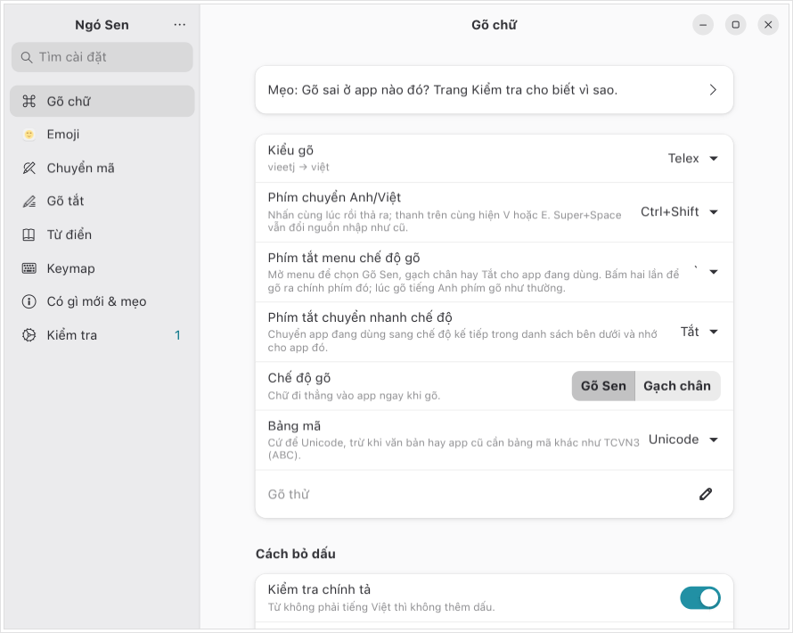

<div align="center">


# Ngó Sen cho IBus

**Bộ gõ tiếng Việt chạy trên IBus có sẵn của nhiều distro, dùng chung lõi gõ với bản fcitx5.**

[](https://github.com/ngosen/ibus-ngosen/releases/latest)
[](LICENSE)
[](#cai-dat)

[Cài đặt](#cai-dat) · [Tính năng](#tinh-nang) · [Khắc phục sự cố](#khac-phuc-su-co) · [CHANGELOG](CHANGELOG.md) · [Báo lỗi](https://github.com/ngosen/ibus-ngosen/issues)

</div>

---

Ngó Sen có hai phiên bản: [fcitx5](https://github.com/ngosen/ngosen) và IBus (bản này). Cả hai dùng chung lõi gõ và gần như tương đương 1:1; dùng bản nào là tuỳ sở thích, bản nào cũng được. Trên distro dùng IBus mặc định, như các distro dùng GNOME (Ubuntu, Fedora Workstation), bản IBus là lựa chọn đơn giản: cài package rồi thêm nguồn nhập, không cần thiết lập gì khác. Tính năng mới có thể đến bản IBus muộn hơn một chút.

Ngoài GNOME, bản IBus đã được thử nghiệm gõ trên Linux Mint Cinnamon (X11), Xfce (X11) và KDE Plasma (Wayland).

Cửa sổ cài đặt theo giao diện sáng/tối của máy, lưu thay đổi ngay và có nút Hoàn tác.

<p align="center">
  <picture>
    <source media="(prefers-color-scheme: dark)" srcset="docs/screenshots/settings-dark.png">
    
  </picture>
</p>

## Mục lục

- [✨ Tính năng nổi bật](#tinh-nang)
- [📦 Cài đặt](#cai-dat)
- [🛠️ Thiết lập sau khi cài đặt](#thiet-lap)
- [🔄 Chuyển qua lại với bản fcitx5](#chuyen-ban)
- [🔍 Khắc phục sự cố thường gặp](#khac-phuc-su-co)
- [🗑️ Gỡ cài đặt](#go-cai-dat)
- [🏗️ Dựng từ mã nguồn](#dung-tu-ma-nguon)
- [🏛️ Nguồn gốc & ghi công](#nguon-goc)
- [English](#english)

<a id="tinh-nang"></a>

## ✨ Tính năng nổi bật

- **Gõ thẳng không gạch chân (Gõ Sen):** mặc định ở mọi app như bản fcitx5, chữ hiện thẳng vào ô gõ, không gạch chân.
- **Menu chế độ riêng cho từng app:** bấm phím `` ` `` để mở menu cạnh con trỏ, chọn **Gõ Sen**, **Gạch chân** hoặc **Tắt** để đổi riêng cho app đang dùng; Ngó Sen nhớ lựa chọn đó cho app ấy. Gặp app gõ sai thì chuyển app đó sang Gạch chân và báo cho Ngó Sen. Menu ghi rõ đang đổi chế độ gõ cho app nào và đánh dấu ✓ cạnh chế độ đang dùng. Cửa sổ cài đặt cho đổi thứ tự hay ẩn bớt các chế độ trong menu, và đặt phím chuyển thẳng sang chế độ kế tiếp không cần mở menu. Muốn gạch chân ở mọi app chưa chọn riêng thì chọn Gạch chân ở mục "Chế độ gõ" trong cửa sổ cài đặt.
- **Phím chuyển Anh/Việt riêng (Ctrl+Shift):** nhấp `Ctrl + Shift` để đổi Anh/Việt như UniKey; thanh trên cùng (hoặc khay IBus) hiện chữ V hoặc E. Như bản fcitx5, phím này đổi mọi app cùng lúc, trừ app đã chọn Tắt trong menu `` ` ``; muốn mỗi app nhớ riêng thì chọn "Từng app" ở "Phím chuyển áp dụng cho". Cửa sổ cài đặt cho đổi sang `Shift + Alt`, hoặc tắt phím này nếu không cần. Muốn đổi cả khi chưa bấm vào ô nào, như `Alt + Z` của UniKey, thêm lệnh `ngosen-toggle` ở Cài đặt › Bàn phím › Phím tắt › Phím tắt tự chọn. `Super + Space` vẫn đổi nguồn nhập như các nguồn nhập khác của GNOME.
- **Cứu chữ:** lỡ gõ chữ lúc đang ở tiếng Anh thì chuyển sang tiếng Việt, Cứu chữ gõ lại chữ đó có dấu (`vieetj` → `việt`), nhấn `Tab` hoặc `Esc` để lấy lại chữ đã gõ.
- **Cứu dấu:** ở chế độ Gõ Sen, chỉ cần bấm chuột ngay sau một từ rồi gõ phím dấu thanh để thêm, đổi hoặc bỏ dấu thanh; trên các app X11, bôi đen chữ rồi gõ phím dấu thanh.
- **Vim mode riêng cho từng app:** bật/tắt Vim mode riêng cho từng app từ menu `` ` `` (tiện cho app dùng phím Vim như nvim).
- **Lệnh và đường dẫn:** từ và đường dẫn bắt đầu bằng `/` được giữ nguyên như khi gõ (`/cost`, `cd /usr/share`).
- **Gợi ý emoji khi gõ:** emoji của các từ như `cười`, `con mèo`, `haha` hiện thành một hàng cạnh con trỏ ngay khi gõ; sau `. ! ?` hoặc khi dừng tay, bấm số để chọn (gõ VNI thì bấm `Tab` trước), `Esc` ẩn hàng emoji tới câu sau. Từ tiếng Anh như `cat`, `thumbs up` cũng có emoji. Muốn hiện sau mỗi từ như trước thì chọn "Sau mỗi từ" ở "Gợi ý emoji" trên trang **Emoji**. Có thể tắt riêng cho app đang dùng bằng mục "Gợi ý emoji" (phím `w`) trong menu `` ` ``. Trang **Emoji** trong cửa sổ cài đặt liệt kê toàn bộ emoji và từ gợi ý, cho phép tìm kiếm, bấm vào từ để bật/tắt, thêm từ của riêng mình, bật lại emoji cho app đã tắt, xuất và nhập danh sách từ (dùng chung với bản fcitx5).
- **Chuyển mã:** bôi đen đoạn chữ gõ bằng bảng mã cũ (TCVN3, VNI…) rồi bấm phím chuyển mã để đổi sang Unicode hoặc bảng mã khác ngay tại chỗ, hỗ trợ đổi chữ hoa/thường và bỏ dấu. Đặt phím tắt và bảng mã trên trang **Chuyển mã** trong cửa sổ cài đặt; trang này cũng có ô để dán chữ và đổi trực tiếp. Hoạt động trong các app GTK và Firefox (LibreOffice chưa hỗ trợ).
- **Gõ tắt, từ điển riêng và bảng phím riêng:** hỗ trợ gõ tắt (macro), từ điển riêng và bảng phím tùy chỉnh. Sửa `ngosen.conf`, bảng gõ tắt hay bảng phím có hiệu lực ngay từ chữ gõ tiếp theo.
- **Trang "Kiểm tra":** kiểm tra IBus, nguồn nhập và biến môi trường của hệ thống, giúp sửa nhanh một số bước bằng một nút bấm và chép kết quả để gửi kèm báo lỗi.
- **Sao lưu và khôi phục:** dùng chung và trao đổi dữ liệu sao lưu với bản fcitx5 (mang theo cả thiết lập, từ điển và danh sách emoji).
- **Nhật ký gõ:** nếu gõ ra chữ sai, chọn "Lưu nhật ký gõ" trong menu nguồn nhập ngay sau đó để lưu những gì vừa gõ vào `~/.local/state/ngosen/` (chỉ tài khoản của bạn đọc được). Đọc lại file rồi gửi kèm báo lỗi.
- **Gõ thừa phím vẫn giữ dấu & nhận diện tiếng Anh:** gõ thừa phím sau từ tiếng Việt vẫn giữ chữ (`dduowjcd` ra `đượcd`), bấm Space bỏ phím thừa (`được`), tách `côngty` thành `công ty` hoặc đổi `nhưg` thành `nhưng`; bấm Backspace ngay sau đó khôi phục những gì đã gõ. Chữ không phải tiếng Việt như `rose`, `case` hiện đúng phím đã gõ.

Bản fcitx5 vẫn có những điểm mà bản IBus chưa có: Cứu dấu trên chữ đang bôi đen ở mọi app (thay vì chỉ ở app X11), và Chuyển mã trong LibreOffice. Nếu cần các tính năng này, hãy dùng [Ngó Sen đầy đủ cho fcitx5](https://github.com/ngosen/ngosen).

Chi tiết từng version ở [CHANGELOG.md](CHANGELOG.md).

<a id="cai-dat"></a>
<a id="cài"></a>

## 📦 Cài đặt

Tải package đúng distro và kiến trúc từ [release mới nhất](https://github.com/ngosen/ibus-ngosen/releases/latest), rồi cài bằng trình quản lý gói, trong thư mục vừa tải về:

```bash
sudo apt install ./ibus-ngosen_*.deb         # Debian, Kali, Ubuntu, Linux Mint
sudo dnf install ./ibus-ngosen-*.rpm         # Fedora
sudo pacman -U ./ibus-ngosen-*.pkg.tar.zst   # Arch, CachyOS
sudo zypper install ./ibus-ngosen-*.rpm      # openSUSE Tumbleweed
```

Có package cho Debian 13, Kali, Ubuntu 24.04 trở lên, Fedora 43 và 44, Arch, CachyOS và openSUSE Tumbleweed. Linux Mint 22 dùng package của Ubuntu 24.04. Có package ARM 64-bit cho Debian, Ubuntu và Fedora; Arch và openSUSE chỉ có x86_64. Không có package cho Debian 12 và Ubuntu 22.04.

Hai bản không chạy cùng lúc trong một tài khoản; nếu đang dùng [bản fcitx5](https://github.com/ngosen/ngosen), xem [Chuyển qua lại với bản fcitx5](#chuyen-ban).

### Cài qua kho phần mềm

Trên Fedora, có thể cài từ kho COPR để `dnf upgrade` tự lên version mới:

```bash
sudo dnf copr enable nguyenphi/ngosen
sudo dnf install ibus-ngosen
```

Trên Debian, Ubuntu, Arch và openSUSE, có thể cài từ kho APT, pacman, zypper của Ngó Sen để `apt upgrade`, `pacman -Syu`, `zypper up` tự lên version mới: thêm kho theo [hướng dẫn của bản fcitx5](https://github.com/ngosen/ngosen#cập-nhật-bằng-trình-quản-lý-gói), rồi cài `ibus-ngosen` thay cho `fcitx5-ngosen`.

Trên Arch và các distro dựa trên Arch, còn có thể cài từ AUR, tự build trên máy:

```bash
yay -S ibus-ngosen
```

<a id="thiet-lap"></a>

## 🛠️ Thiết lập sau khi cài đặt

### Trên GNOME

1. Đăng xuất rồi đăng nhập lại, để IBus thấy bộ gõ vừa cài.
2. Mở **Settings** → **Keyboard** → **Input Sources** (hoặc **Cài đặt** › **Bàn phím** › **Nguồn nhập**), thêm "Tiếng Việt (Ngó Sen)".

Lần đầu gõ bằng Ngó Sen, nó tự bỏ nguồn nhập "Tiếng Anh (Mỹ)" vì `Ctrl + Shift` đã chuyển sang tiếng Anh, nên chỉ còn một nguồn nhập. Việc này chỉ làm một lần: thêm lại "Tiếng Anh (Mỹ)" thì nó được giữ, và bàn phím của ngôn ngữ khác không bị đụng tới. Nếu lúc đó phím `Ctrl + Shift` đang tắt thì Ngó Sen không bỏ nguồn nào, kể cả khi bật phím lại sau này. Mục "Kiểm tra" trong cửa sổ cài đặt có nút "Chỉ dùng Ngó Sen" để bỏ nó sau. Ngó Sen luôn gõ trên bàn phím kiểu Mỹ, kể cả khi đang ở tiếng Anh bằng `Ctrl + Shift`.

### Trên desktop khác GNOME (Cinnamon, Xfce, KDE Plasma)

1. Chạy `im-config -n ibus` nếu máy có `im-config`. Trên KDE Plasma Wayland, vào **Thiết lập hệ thống** › **Bàn phím** › **Bàn phím ảo**, chọn "IBus Wayland".
2. Mở IBus Preferences bằng lệnh `ibus-setup`, thêm "Tiếng Việt (Ngó Sen)", hoặc bấm "Thêm Ngó Sen" ở mục "Kiểm tra" trong cửa sổ cài đặt. Cinnamon giữ phím Super cho menu nên `Super + Space` không tới được IBus; đặt phím chuyển khác như `Ctrl + Space` ở tab General.
3. Đăng xuất rồi đăng nhập lại.

Mở cửa sổ cài đặt từ **Cài đặt** › **Bàn phím** › **"Tiếng Việt (Ngó Sen)"**, hoặc tìm "Ngó Sen" trong danh sách app. Đổi gì lưu ngay; nút Hoàn tác trên thông báo ở đáy đưa cài đặt về như trước lần đổi đó.

<a id="chuyen-ban"></a>
<a id="chuyển-qua-lại-với-bản-fcitx5"></a>

## 🔄 Chuyển qua lại với bản fcitx5

- **Từ bản fcitx5 sang bản này:** gỡ bản fcitx5 bằng `install.sh --uninstall` như hướng dẫn của nó, rồi cài bản này. Nếu đã gỡ bằng trình quản lý gói, lệnh cài fcitx5 có thể còn để lại biến môi trường hay mục tự chạy làm app vẫn đi qua fcitx5: mở tab "Kiểm tra" trong cửa sổ cài đặt, bấm "Xoá" ở bước "Tài khoản này còn cài đặt của bản fcitx5" rồi đăng xuất và đăng nhập lại. Nút chỉ xoá những tệp còn y nguyên như lệnh cài đã ghi; tệp đã sửa tay thì bước kế bên chỉ ra đường dẫn để tự sửa.
- **Từ bản này sang bản fcitx5:** trong cửa sổ cài đặt, mục "Có ở bản fcitx5" có lệnh cài để chép. Trên Debian và Ubuntu lệnh tự thay bản này; trên Fedora, openSUSE và Arch, chép lệnh, gỡ `ibus-ngosen` rồi mới chạy.
- **Đồng bộ cài đặt:** cài đặt chỉ được chép một lần, lúc bản này chạy lần đầu trên máy đã có bản fcitx5 (kiểu gõ, gõ tắt, bảng phím riêng và từ điển riêng được chép sang, từ điển vào `~/.local/share/ngosen/`; file của fcitx5 giữ nguyên). Sau đó hai bản không đồng bộ với nhau; muốn mang thay đổi sang bản kia thì sao lưu ở bản này rồi khôi phục ở bản kia. Trước khi khôi phục một bản sao lưu của bản này vào bản fcitx5, hãy sao lưu cài đặt của bản fcitx5: bản fcitx5 cũ hơn [ngosen/ngosen#648](https://github.com/ngosen/ngosen/pull/648) xoá các app đã chọn riêng tiếng Việt hay tiếng Anh.

<a id="khac-phuc-su-co"></a>

## 🔍 Khắc phục sự cố thường gặp

### GNOME 50.0–50.3 làm mất phím

GNOME 50.0–50.3 (như Ubuntu 26.04) làm mất phím Ngó Sen gửi tới app, nên gói kèm một extension sửa lỗi này: đăng nhập lại một lần là Ngó Sen tự bật extension, chưa chạy thì chữ vẫn gạch chân.

### Không gõ được tiếng Việt

Mở mục "Kiểm tra" trong cửa sổ cài đặt: nó kiểm tra IBus, nguồn nhập và biến môi trường, sửa được vài bước bằng một nút bấm, và chép kết quả để gửi kèm báo lỗi.
Tab Kiểm tra đọc biến bộ gõ (`GTK_IM_MODULE`, `QT_IM_MODULE`, `XMODIFIERS`) từ bộ gõ desktop đã chạy lúc đăng nhập. Trên Xfce, Cinnamon, KDE Plasma và các desktop khác GNOME, tab báo thiếu nếu chưa có trong danh sách IBus và có nút "Thêm Ngó Sen" (sau khi bấm, đăng xuất rồi đăng nhập lại nếu menu chưa có Ngó Sen). Trên KDE Plasma Wayland, khi IBus không chạy, tab chỉ tới Bàn phím ảo.

### Gõ ra chữ sai hoặc lỗi bộ gõ

- **Lưu nhật ký gõ:** chọn "Lưu nhật ký gõ" trong menu nguồn nhập ngay sau khi gõ sai: những gì vừa gõ được lưu vào `~/.local/state/ngosen/`, chỉ tài khoản của bạn đọc được. Đọc lại file rồi gửi kèm báo lỗi.
- **Log của engine:** nằm trong journal (`journalctl -t ibus-engine-ngosen`). Muốn có cả log gỡ lỗi thì chạy ibus-daemon với `NGOSEN_DEBUG=1`; chữ gõ trong ô mật khẩu không bao giờ được ghi.

### Cấu hình và thiết lập

Cài đặt nằm trong `~/.config/ngosen/`, cùng định dạng và tên khoá với `ngosen.conf` của Ngó Sen đầy đủ. Sửa `ngosen.conf`, bảng gõ tắt hay bảng phím thì có hiệu lực từ chữ gõ tiếp theo. Xoá `ngosen.conf` là về cài đặt mặc định.

### Báo lỗi

Báo lỗi tại [Issues](https://github.com/ngosen/ibus-ngosen/issues).

<a id="go-cai-dat"></a>
<a id="gỡ"></a>

## 🗑️ Gỡ cài đặt

Bỏ "Tiếng Việt (Ngó Sen)" khỏi nguồn nhập hoặc khỏi IBus Preferences, rồi gỡ bằng trình quản lý gói:

```bash
sudo apt remove ibus-ngosen      # Debian, Kali, Ubuntu, Linux Mint
sudo dnf remove ibus-ngosen      # Fedora
sudo pacman -R ibus-ngosen       # Arch, CachyOS
sudo zypper remove ibus-ngosen   # openSUSE Tumbleweed
```

Gỡ xong, đăng xuất rồi đăng nhập lại. Cài đặt trong `~/.config/ngosen/` được giữ lại.

<a id="dung-tu-ma-nguon"></a>
<a id="dựng-từ-mã-nguồn"></a>

## 🏗️ Dựng từ mã nguồn

Cần IBus ≥ 1.5.27 (gói `libibus-1.0-dev` hoặc `ibus-devel`), CMake, trình dịch C++17, Rust ≥ 1.88, Python 3 và `msgfmt` (gói `gettext`). Cửa sổ cài đặt chạy bằng Python với GTK 4 và libadwaita ≥ 1.5 (`python3-gi`, `gir1.2-adw-1` hoặc `libadwaita`).
Test engine chạy một ibus-daemon riêng, cần thêm `ibus`, `dbus-run-session`, Xvfb, libXtst và `python3-gi` có IBus; bỏ test này bằng `-DNGOSEN_IBUS_DAEMON_TESTS=OFF`. Test cửa sổ cài đặt cần `xvfb-run`, thiếu thì được bỏ qua.

```bash
git clone --recurse-submodules https://github.com/ngosen/ibus-ngosen.git
cd ibus-ngosen
cmake -S . -B build -DCMAKE_BUILD_TYPE=Release
cmake --build build -j"$(nproc)"
ctest --test-dir build
sudo cmake --install build
```

Sau đó đăng xuất rồi đăng nhập lại, và thêm "Tiếng Việt (Ngó Sen)" trong Cài đặt › Bàn phím › Nguồn nhập.

<a id="nguon-goc"></a>
<a id="nguồn-gốc"></a>

## 🏛️ Nguồn gốc & ghi công

- Logic gõ là lõi của [Ngó Sen](https://github.com/ngosen/ngosen), gắn vào repo này làm submodule `ngosen`.
- Ngó Sen dựa trên mã của [fcitx5-lotus](https://github.com/LotusInputMethod/fcitx5-lotus) và [VMK](https://github.com/thanhpy2009/VMK). Giấy phép **GPL-3.0-or-later**.

<a id="english"></a>

## English

Ngó Sen for IBus (`ibus-ngosen`) is a Vietnamese input method on IBus. Ngó Sen comes in two editions: [fcitx5](https://github.com/ngosen/ngosen) and IBus (this one). They share the typing core and are close to 1:1; which one to use is personal taste, either is fine. On a distro that uses IBus by default, such as those shipping GNOME (Ubuntu, Fedora Workstation), the IBus edition is the simple choice: install the package and add the input source, with no other setup. It is licensed under GPL-3.0-or-later. The maintainer only **vibecodes** this project: an AI coding agent writes the code, then the maintainer measures and uses it daily.

Key features include:
- Gõ Sen (direct typing without underline) by default, with Preedit or Off configurable per app via the `` ` `` menu.
- Per-application English/Vietnamese switching with `Ctrl + Shift`.
- Cứu chữ (restoring mistyped words) and Cứu dấu (quick tone correction).
- Emoji suggestions while typing and in-place charset conversion (TCVN3, VNI to Unicode).
- Per-app Vim mode, macros, custom keymaps, and typing logs.

To install, download the package for your distribution from the [latest release](https://github.com/ngosen/ibus-ngosen/releases/latest) and install it using your package manager (`apt`, `dnf`, `pacman`, or `zypper`), or install from software repositories (COPR for Fedora, AUR for Arch via `yay -S ibus-ngosen`). After installing, log out, log back in, and add "Tiếng Việt (Ngó Sen)" under Settings → Keyboard → Input Sources.

The rest of this page is in Vietnamese.
